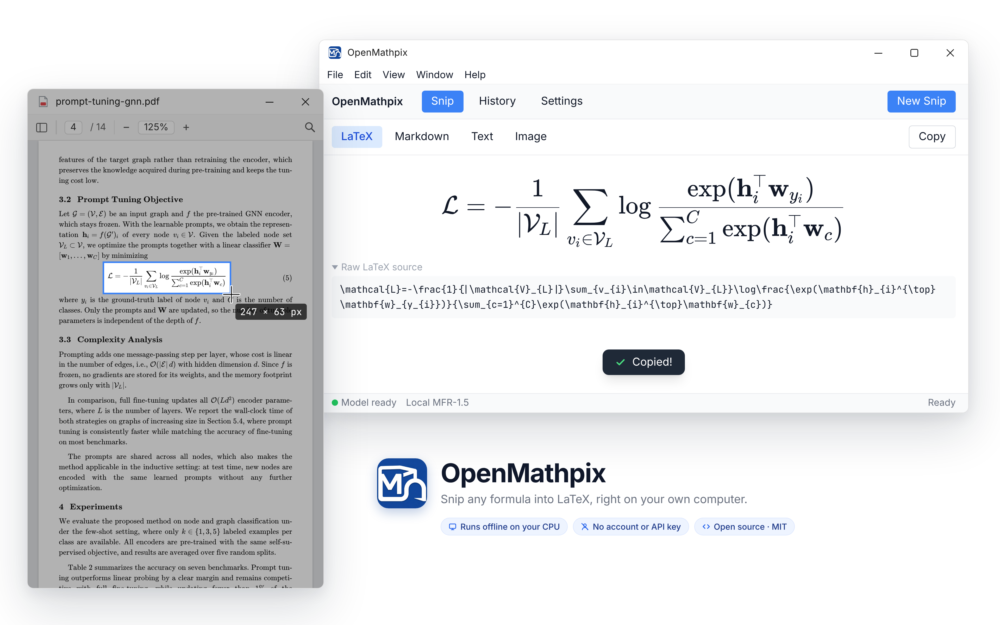

<p align="center">
  
</p>

<h1 align="center">OpenMathpix</h1>

<p align="center">
  <a href="README.zh-CN.md">
    
  </a>
</p>

<p align="center">
  Open-source desktop snipping tool that converts formula screenshots into LaTeX locally with <a href="https://huggingface.co/breezedeus/pix2text-mfr-1.5">Pix2Text MFR-1.5</a>, with optional <a href="https://github.com/PaddlePaddle/PaddleOCR">PaddleOCR</a> APIs for text, tables and document layouts.
</p>

---

## Installation

### Windows (portable, recommended)

1. Open the [latest release](https://github.com/JhuoW/OpenMathpix/releases/latest) and download **OpenMathpix-portable.exe** from **Assets** (Windows x64).
2. For local formula recognition, install the [Microsoft Visual C++ x64 Redistributable](https://aka.ms/vc14/vc_redist.x64.exe) if it is not already installed.
3. Double-click **OpenMathpix-portable.exe** to launch the portable app.
4. Follow [Local formula recognition](#local-formula-recognition-recommended) below to test and use.

### Build from source (optional)

Requires Node.js 22.12 or later and npm.

```bash
git clone git@github.com:JhuoW/OpenMathpix.git
cd OpenMathpix
npm install
npm run dev
npm run check      # TypeScript, ESLint, regression tests, production build
npm run package
```

## Getting started

### Local formula recognition (recommended)

1. Open **Settings**, choose **Local [MFR-1.5](https://huggingface.co/breezedeus/pix2text-mfr-1.5)**, then click **Download Local Model**.
2. The first setup downloads about **120 MB** from the official Hugging Face repository.
   Downloads show progress and verify SHA-256 hashes. Network access is needed for this step;
   subsequent recognition works offline.
3. The app automatically loads and tests the model, then saves the working configuration. Wait
   until the model is ready; no Save button is needed.
4. Snip a single formula with a small margin, paste an image, or drop an image into the window.

No account, API token, Python, GPU, or local language-model server is required. In local mode,
images are processed on your CPU in a separate background process. Sessions use two CPU threads,
stay warm for repeated snips, and are released after five minutes idle. There is no automatic
cloud fallback. New installations select Local MFR-1.5 by default. On the first upgrade to
this version, older settings switch to Local MFR-1.5 once; API credentials and the interface
language are retained. Later engine choices are remembered across restarts. You can select
the local engine before downloading its files; recognition becomes available after model setup.

<div align="center">
  
</div>

MFR recognizes **formula crops**. It does not parse mixed text/formula pages, tables or document
layout. Markdown wraps the result in display math; Text preserves the LaTeX source. Complex
layouts, handwriting and unusual screenshots still need review. Blank/corrupt images, timeouts
and generation length limits produce errors rather than copied partial output.

#### Use a model downloaded manually

If a download fails or times out, check that your network or system proxy can access Hugging
Face and its file download servers, then retry. The app uses the system proxy for downloads.
You can also download the model with a browser or copy it from another computer:

1. Open the [supported MFR-1.5 revision on Hugging Face](https://huggingface.co/breezedeus/pix2text-mfr-1.5/tree/1cef9f0bdcd6a4c63df7de1311fb0894593340cc)
   and place these eight original files together in one folder:

   ```text
   encoder_model.onnx
   decoder_model.onnx
   config.json
   generation_config.json
   preprocessor_config.json
   special_tokens_map.json
   tokenizer.json
   tokenizer_config.json
   ```
2. In **Settings → Local MFR-1.5**, click **Select Local Model** and select that folder.
3. The app checks all eight files and their SHA-256 hashes, then loads the model and runs a
   test formula. It remembers the folder only after these checks succeed. If validation or
   loading fails, the previous working model remains selected.

The selected folder is used directly, so keep it available and do not move or delete it.
The saved selection is restored when you restart the app; no API configuration is required.

When the model is ready, **Download Local Model** is disabled. Use **Clear Model Cache** in
Settings to remove downloaded model files and deactivate the current local model; downloading
becomes available again. Manually selected external folders and their original files are not deleted.

The interface defaults to **English**. Choose **View → Language → English / 简体中文** to change it immediately.
Your choice is saved for the next launch. Closing the window offers **Minimize to taskbar**,
**Quit**, or **Cancel**; minimizing keeps the app and its screenshot shortcut running.

### Optional PaddleOCR: get your API credentials

1. Go to [https://aistudio.baidu.com/paddleocr](https://aistudio.baidu.com/paddleocr) and log in (or create a free Baidu AIStudio account).
2. Click **"API"** button to access the model list. Then select a model (e.g. PaddleOCR-VL) to reveal the example code and your unique API URL and Access Token.

<div align="center">
  
</div>
3. Copy these two values from the example:

- **API URL** — your unique endpoint, e.g. `https://xxxxxx.aistudio-app.com/layout-parsing`
- **Access Token** — your authentication token (also at [https://aistudio.baidu.com/index/accessToken](https://aistudio.baidu.com/index/accessToken))

> **Note:** Each model gets its own API URL (different subdomain). If you switch models, copy the new URL too.

### Optional PaddleOCR: configure OpenMathpix

1. Launch OpenMathpix.
2. Click **Settings** in the toolbar.
3. Select **PaddleOCR API**, then under **API Configuration**:
   - Paste your **API URL**.
   - Paste your **Access Token**.
   - Select a **Pipeline** that matches the model you chose on AIStudio.
4. Settings automatically verifies the configuration with a small test image and saves it
   when successful. Wait for the saved status; if verification fails, correct the fields and
   the app will try again. The previously working configuration remains active until then.

<div align="center">
  
</div>

### Capture and recognize

#### Screen snip

You can click **Snip** button in the toolbar and then click **New Snip** button to dim the screen.

<div align="center">
  
</div>

You can click and drag to select a region. Release to capture.

<div align="center">
  
  
</div>

## Viewing results

After recognition, results appear in four tabs:

| Tab                | Description                                                  |
| ------------------ | ------------------------------------------------------------ |
| **LaTeX**    | Extracted math rendered via KaTeX, with copyable raw source. |
| **Markdown** | Structured output (headings, tables, inline math).           |
| **Text**     | Plain text with all formatting stripped.                     |
| **Image**    | The original captured screenshot.                            |

**Raw LaTeX source** is expanded by default for each new result. Click its heading to collapse
or expand the code. Click **Copy** to copy the active tab. The default format is auto-copied
after each recognition.

## Pipelines

| Pipeline                   | Best for                               | Output                   |
| -------------------------- | -------------------------------------- | ------------------------ |
| **MFR-1.5 (local)**  | Single formula screenshots             | LaTeX + display Markdown |
| **PP-OCRv5**         | General text (CJK + English)           | Text only                |
| **PP-StructureV3**   | Math, tables, charts, mixed layout     | Markdown + LaTeX         |
| **PaddleOCR-VL**     | Vision-language document parsing       | Markdown + LaTeX         |
| **PaddleOCR-VL-1.5** | Higher accuracy, seal & irregular text | Markdown + LaTeX         |

> Each pipeline has its own API URL on AIStudio. When switching pipelines, update the URL in Settings to match.

## Settings

| Setting        | Default          | Description                                                            |
| -------------- | ---------------- | ---------------------------------------------------------------------- |
| OCR Engine     | Local MFR-1.5    | Offline formulas or PaddleOCR API; saved API credentials are retained. |
| API URL        | —               | Your PaddleOCR AIStudio endpoint.                                      |
| Access Token   | —               | Stored encrypted on disk via safeStorage.                              |
| Pipeline       | PP-StructureV3   | Which OCR pipeline to use.                                             |
| Snip Hotkey    | `Ctrl+Shift+S` | Global shortcut for screen capture.                                    |
| Default Output | LaTeX            | Format auto-copied after recognition.                                  |
| Theme          | System           | Light / Dark / System.                                                 |
| History Limit  | 100              | Max saved recognitions (10–500).                                      |

**Self-hosted:** Set the API URL to your local server (e.g. `http://localhost:8080`) and leave the token empty.

Settings save automatically and take effect after validation. Text fields apply after a short
pause in typing or when you leave the field; dropdowns and switches apply on selection. Model
and API changes show their validation or loading status. Failed changes leave the previous
working configuration active, and successfully saved settings are restored on restart.

An unavailable hotkey, invalid URL or history limit, model loading failure, or unavailable
system keyring is reported in Settings so you can correct it without losing the working setup.

## History

Click **History** in the toolbar to browse past recognitions. Each entry shows a thumbnail, timestamp, and preview. Use the search bar to filter, or click an entry to re-open its result.

<div align="center">
  
</div>

## System tray

Closing the window minimizes to tray. Right-click the tray icon for:

- **Snip** — start capture
- **Open Window** — show main window
- **Settings** — open settings
- **Quit** — exit

## Keyboard shortcuts

| Shortcut         | Action                      |
| ---------------- | --------------------------- |
| `Ctrl+Shift+S` | Screen snip (global)        |
| `Ctrl+V`       | Paste image for recognition |
| `Escape`       | Cancel snip                 |

## License

MIT
