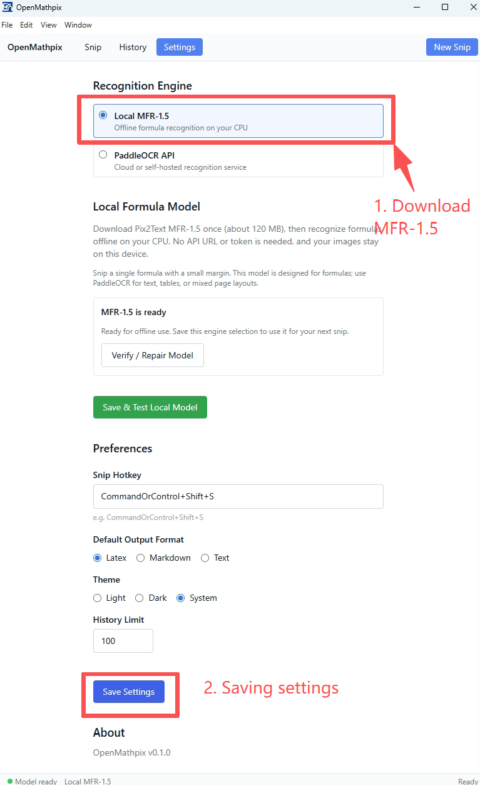
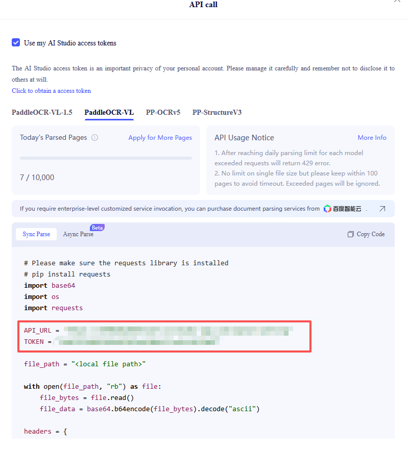
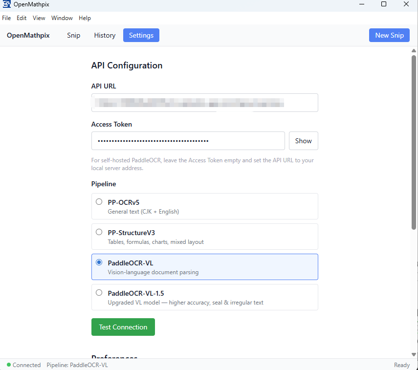
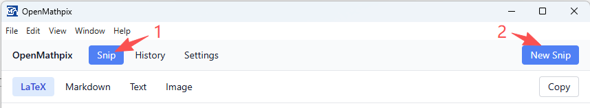
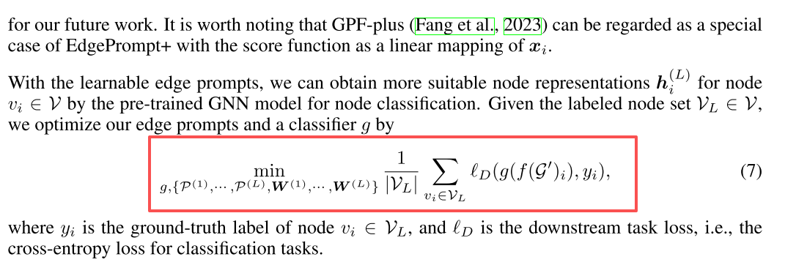
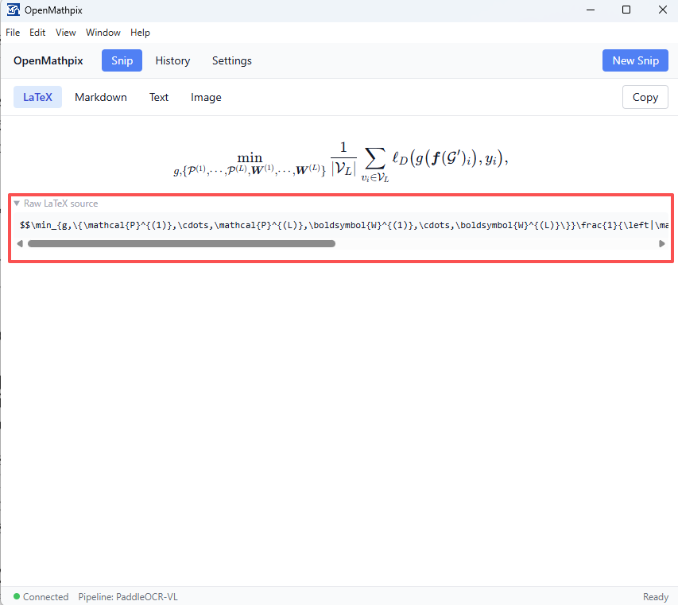
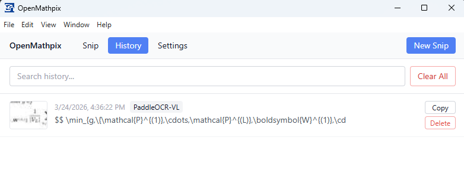

<p align="center">
  
</p>

<h1 align="center">OpenMathpix</h1>

<p align="center">
  <a href="README.zh-CN.md">
    
  </a>
</p>

<p align="center">
  Open-source desktop snipping tool that converts formula screenshots into LaTeX locally with <a href="https://huggingface.co/breezedeus/pix2text-mfr-1.5">Pix2Text MFR-1.5</a>, with optional <a href="https://github.com/PaddlePaddle/PaddleOCR">PaddleOCR</a> APIs for text, tables and document layouts.
</p>

---

## Installation

### Windows (portable)

1. Open the [latest release](https://github.com/JhuoW/OpenMathpix/releases/latest) and download **OpenMathpix-portable.exe** from **Assets** (Windows x64).
2. For local formula recognition, install the [Microsoft Visual C++ x64 Redistributable](https://aka.ms/vc14/vc_redist.x64.exe) if it is not already installed.
3. Double-click **OpenMathpix-portable.exe** to launch the portable app.
4. Follow [Local formula recognition](#local-formula-recognition-recommended) below to download and test MFR-1.5.

### Build from source

Requires Node.js 22.12 or later and npm.

```bash
git clone git@github.com:JhuoW/OpenMathpix.git
cd OpenMathpix
npm install
npm run dev
npm run check      # TypeScript, ESLint, regression tests, production build
npm run package
```

## Getting started

### Local formula recognition (recommended)

1. Open **Settings**, choose **Local [MFR-1.5](https://huggingface.co/breezedeus/pix2text-mfr-1.5)**, then click **Download MFR-1.5**.
2. The first setup downloads about **120 MB** from the official Hugging Face repository.
   Downloads show progress, verify SHA-256 hashes, and can be retried. Network access is
   needed for this step; subsequent recognition works offline.
3. Click **Save & Test Local Model** to save the selection and run a small formula.
4. Snip a single formula with a small margin, paste an image, or drop an image into the window.

No account, API token, Python, GPU, or local language-model server is required. In local mode,
images are processed on your CPU in a separate background process. Sessions use two CPU threads,
stay warm for repeated snips, and are released after five minutes idle. There is no automatic
cloud fallback. New installations default to MFR; existing installations with a configured
PaddleOCR URL retain their cloud engine and credentials.

<div align="center">
  
</div>

MFR recognizes **formula crops**. It does not parse mixed text/formula pages, tables or document
layout. Markdown wraps the result in display math; Text preserves the LaTeX source. Complex
layouts, handwriting and unusual screenshots still need review. Blank/corrupt images, timeouts
and generation length limits produce errors rather than copied partial output.

Model files live in Electron's user-data directory under
`models/mfr-1.5/1cef9f0bdcd6a4c63df7de1311fb0894593340cc/` (typically
`~/.config/openmathpix/` on Linux). The pinned model revision and all checksums are in
`src/services/mfr-model.ts`. To install offline, copy those eight original files from another
machine into the same directory. The app verifies them on startup.

### Optional PaddleOCR: get your API credentials

1. Go to [https://aistudio.baidu.com/paddleocr](https://aistudio.baidu.com/paddleocr) and log in (or create a free Baidu AIStudio account).
2. Click **"API"** button to access the model list. Then select a model (e.g. PaddleOCR-VL) to reveal the example code and your unique API URL and Access Token.

<div align="center">
  
</div>
3. Copy these two values from the example:

- **API URL** — your unique endpoint, e.g. `https://xxxxxx.aistudio-app.com/layout-parsing`
- **Access Token** — your authentication token (also at [https://aistudio.baidu.com/index/accessToken](https://aistudio.baidu.com/index/accessToken))

> **Note:** Each model gets its own API URL (different subdomain). If you switch models, copy the new URL too.

### Optional PaddleOCR: configure OpenMathpix

1. Launch OpenMathpix.
2. Click **Settings** in the toolbar.
3. Select **PaddleOCR API**, then under **API Configuration**:
   - Paste your **API URL**.
   - Paste your **Access Token**.
   - Select a **Pipeline** that matches the model you chose on AIStudio.
4. Click **Save & Test Connection** to save your inputs and verify them with a small test image.
<div align="center">
  
</div>

### Capture and recognize

#### Screen snip

You can click **Snip** button in the toolbar and then click **New Snip** button to dim the screen.

<div align="center">
  
</div>

You can click and drag to select a region. Release to capture.

<div align="center">
  
  
</div>

## Viewing results

After recognition, results appear in four tabs:

| Tab          | Description                                                  |
| ------------ | ------------------------------------------------------------ |
| **LaTeX**    | Extracted math rendered via KaTeX, with copyable raw source. |
| **Markdown** | Structured output (headings, tables, inline math).           |
| **Text**     | Plain text with all formatting stripped.                     |
| **Image**    | The original captured screenshot.                            |

Click **Copy** to copy the active tab. The default format is auto-copied after each recognition.

## Pipelines

| Pipeline             | Best for                               | Output                   |
| -------------------- | -------------------------------------- | ------------------------ |
| **MFR-1.5 (local)**  | Single formula screenshots             | LaTeX + display Markdown |
| **PP-OCRv5**         | General text (CJK + English)           | Text only                |
| **PP-StructureV3**   | Math, tables, charts, mixed layout     | Markdown + LaTeX         |
| **PaddleOCR-VL**     | Vision-language document parsing       | Markdown + LaTeX         |
| **PaddleOCR-VL-1.5** | Higher accuracy, seal & irregular text | Markdown + LaTeX         |

> Each pipeline has its own API URL on AIStudio. When switching pipelines, update the URL in Settings to match.

## Settings

| Setting        | Default        | Description                                                              |
| -------------- | -------------- | ------------------------------------------------------------------------ |
| OCR Engine     | Local MFR-1.5  | Offline formulas or PaddleOCR API; existing cloud settings are retained. |
| API URL        | —              | Your PaddleOCR AIStudio endpoint.                                        |
| Access Token   | —              | Stored encrypted on disk via safeStorage.                                |
| Pipeline       | PP-StructureV3 | Which OCR pipeline to use.                                               |
| Snip Hotkey    | `Ctrl+Shift+S` | Global shortcut for screen capture.                                      |
| Default Output | LaTeX          | Format auto-copied after recognition.                                    |
| Theme          | System         | Light / Dark / System.                                                   |
| History Limit  | 100            | Max saved recognitions (10–500).                                         |

**Self-hosted:** Set the API URL to your local server (e.g. `http://localhost:8080`) and leave the token empty.

Click **Save Settings** to apply changes. Hotkey and theme changes take effect immediately. If a
hotkey is unavailable, the previous settings and shortcut are retained. Invalid URLs and history
limits are rejected; an unavailable system keyring is reported when saving a token.

## History

Click **History** in the toolbar to browse past recognitions. Each entry shows a thumbnail, timestamp, and preview. Use the search bar to filter, or click an entry to re-open its result.

<div align="center">
  
</div>

## System tray

Closing the window minimizes to tray. Right-click the tray icon for:

- **Snip** — start capture
- **Open Window** — show main window
- **Settings** — open settings
- **Quit** — exit

## Keyboard shortcuts

| Shortcut       | Action                      |
| -------------- | --------------------------- |
| `Ctrl+Shift+S` | Screen snip (global)        |
| `Ctrl+V`       | Paste image for recognition |
| `Escape`       | Cancel snip                 |

## License

MIT
