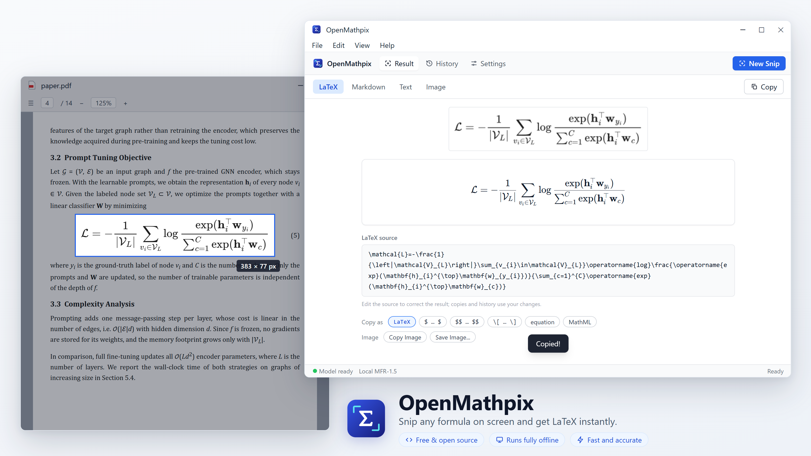
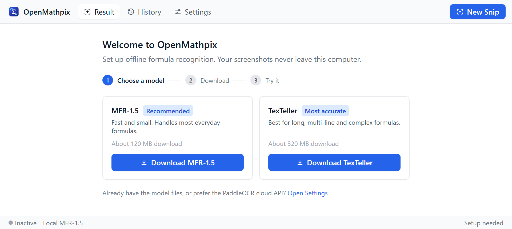
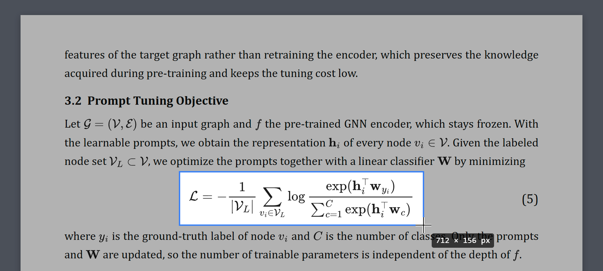
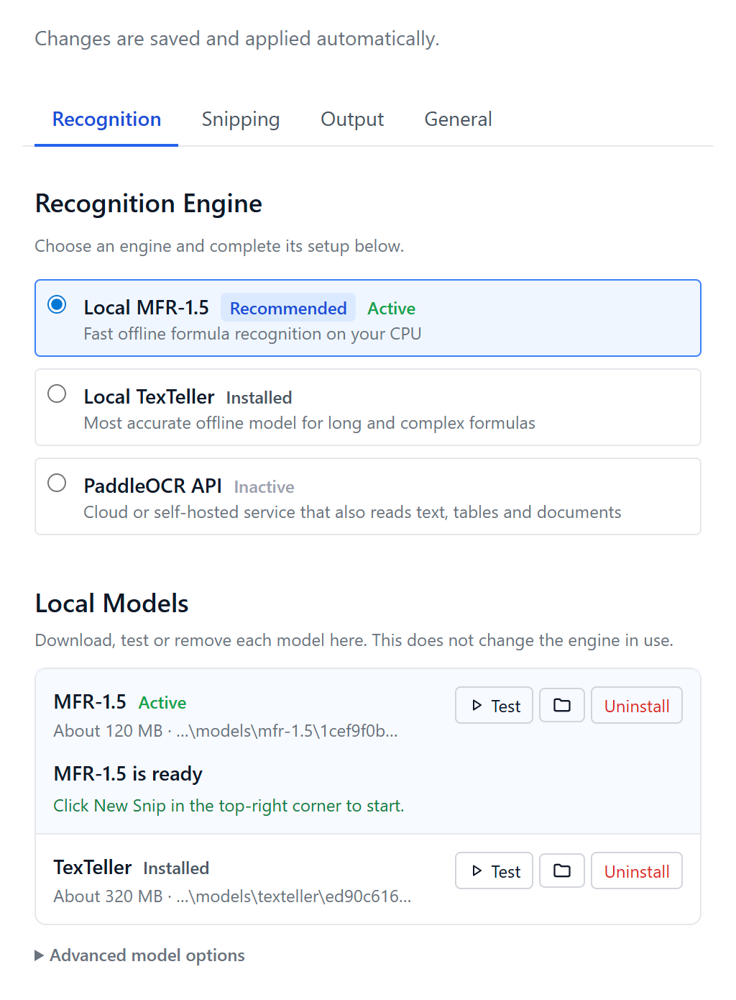
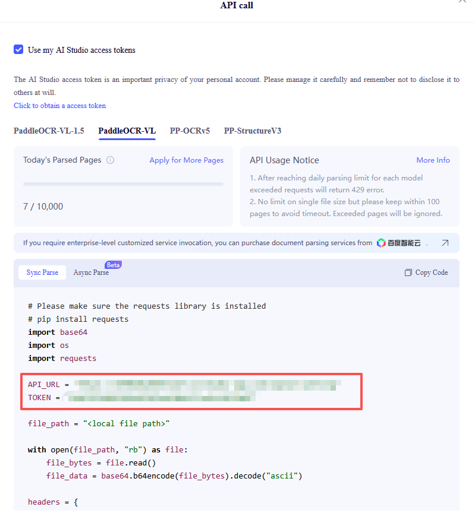
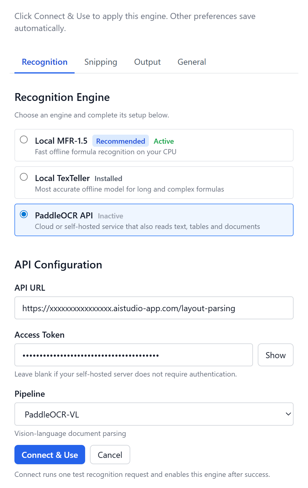

<p align="center">
  
</p>

<p align="center">
  <b>OpenMathpix: Snip any formula on screen and get LaTeX instantly.</b><br />
  Free and open source · Runs fully offline · Fast and accurate
</p>

<p align="center">
  <a href="https://github.com/JhuoW/OpenMathpix/releases/latest"></a>
  <a href="LICENSE"></a>
  <a href="README.zh-CN.md"></a>
</p>

## Features

- **Snip from anything.** PDFs, slides, web pages, videos, scanned notes. Press `Ctrl+Shift+S`, drag
  around a formula, and the LaTeX is already on your clipboard. You can also paste or drop an image.
- **Private by design.** Recognition runs on your CPU. Your screenshots never leave your computer.
- **Two local models.** A fast default for everyday formulas, and a larger one for long,
  multi-line and matrix-heavy formulas. Each downloads once with one click and then works offline.
- **Paste-ready output.** Copy as LaTeX, `$…$`, `$$…$$`, `\[…\]`, an `equation` environment, or
  MathML for an editable Microsoft Word equation. Need a picture instead? **Copy Image** or **Save Image…** as PNG or SVG.
- **Easy to correct.** Fix a symbol in the source and the preview updates as you type. Recent
  results are kept in a searchable history.
- **Stays out of your way.** Lives in the system tray and starts with Windows. Optionally copies in
  the background and shows a small popup instead of opening the window.
- English and 简体中文 interface, light and dark themes, and in-app updates.

## Download

1. Download **OpenMathpix-Setup-&lt;version&gt;-x64.exe** from the
   [latest release](https://github.com/JhuoW/OpenMathpix/releases/latest) (Windows 10 or 11, x64).
2. Run it. The installer is not code-signed yet, so Windows SmartScreen may say
   *Windows protected your PC*. Click **More info → Run anyway**. Each release also publishes a
   `.sha256` checksum you can compare with `certutil -hashfile <file> SHA256`.
3. Local models need the [Microsoft Visual C++ Redistributable (x64)](https://aka.ms/vc14/vc_redist.x64.exe),
   which most PCs already have. If a model fails to load, install it and try again.

## Getting started

1. **Pick a model.** On first launch, a short guide helps you choose and download a model
   (about 120 MB), then tests it on a sample formula.

   
2. **Snip.** Press `Ctrl+Shift+S` in any app, or click **New Snip**. The screen dims; drag around
   the formula, leaving a small margin. Press `Esc` or right-click to cancel.

   
3. **Paste.** The result is copied automatically. Change the default format in
   **Settings → Output**, or use **Copy as** on the result page.

## Choosing a model

|               | **MFR-1.5** (default)  | **TexTeller**                                           |
| ------------- | ---------------------------- | ------------------------------------------------------------- |
| Best for      | Single formulas, inline math | Long, multi-line formulas, matrices, cases, aligned equations |
| Speed         | Fastest                      | Slower, most accurate                                         |
| Download      | About 120 MB                 | About 320 MB                                                  |
| Memory in use | About 0.3 GB                 | About 0.8 GB                                                  |

You can install both and switch any time in **Settings → Recognition**. Only the model in use is
loaded, and it is released after a few idle minutes. **Local Models** lets you test a model on a
sample formula, open its folder, or remove it.

Downloads come from Hugging Face and every file is checked against a pinned SHA-256 hash. If
Hugging Face is slow or blocked, open **Advanced model options** and switch **Download source** to
**hf-mirror.com**. Cancelled downloads resume where they stopped.

<p align="center">
  
</p>

## Keyboard shortcuts

| Shortcut                | Action                                 |
| ----------------------- | -------------------------------------- |
| `Ctrl+Shift+S`        | Snip from any app (change in Settings) |
| `Ctrl+N`              | New snip from the app window           |
| `Ctrl+V`              | Recognize a pasted image               |
| `Ctrl+Shift+V`        | Recognize the image on the clipboard   |
| `Ctrl+Shift+C`        | Copy the current result                |
| `Ctrl+1` / `Ctrl+2` | Result / History                       |
| `Ctrl+,`              | Settings                               |
| `Esc` / right-click   | Cancel a snip                          |

## More

<details>
<summary><b>Text, tables and whole pages with PaddleOCR (optional, online)</b></summary>

<br />

The local models read formulas. For text, tables and mixed document pages, you can connect the
[PaddleOCR](https://github.com/PaddlePaddle/PaddleOCR) service from Baidu AI Studio (free account)
or your own PaddleOCR server. With this engine, your snips are sent to that service.

1. Sign in at [aistudio.baidu.com/paddleocr](https://aistudio.baidu.com/paddleocr), click **API**,
   choose a model, and copy the `API_URL` and `TOKEN` from the example code.

   
2. In **Settings → Recognition**, choose **PaddleOCR API**, paste the **API URL** and
   **Access Token**, and select the matching **Pipeline**.
3. Click **Connect & Use**. OpenMathpix sends one small test image and switches to PaddleOCR only
   if it works. The token is stored encrypted.

   

| Pipeline         | Best for                                      |
| ---------------- | --------------------------------------------- |
| PP-OCRv5         | Plain text, Chinese and English               |
| PP-StructureV3   | Formulas, tables, charts and mixed layouts    |
| PaddleOCR-VL     | Document parsing with a vision-language model |
| PaddleOCR-VL-1.5 | Higher accuracy, seals and irregular text     |

Each pipeline has its own API URL. Update the URL when you switch pipelines. For a self-hosted
server, enter its address (for example `http://localhost:8080`) and leave the token empty.

</details>

<details>
<summary><b>Install a model without the in-app download</b></summary>

<br />

Download the files below with a browser (or copy them from another computer), put them in one
folder, then choose **Settings → Recognition → Local Models → Import…** and select that folder.
OpenMathpix checks every file and uses the folder in place, so keep it where it is.

- **MFR-1.5**, from [this revision](https://huggingface.co/breezedeus/pix2text-mfr-1.5/tree/1cef9f0bdcd6a4c63df7de1311fb0894593340cc):
  `encoder_model.onnx`, `decoder_model.onnx`, `config.json`, `generation_config.json`,
  `preprocessor_config.json`, `special_tokens_map.json`, `tokenizer.json`, `tokenizer_config.json`
- **TexTeller**, from [this revision](https://huggingface.co/onnx-community/TexTeller3-ONNX/tree/ed90c6164810242882ca90863bb85697a76f4841):
  `onnx/encoder_model_int8.onnx`, `onnx/decoder_model_merged_int8.onnx`, `config.json`,
  `generation_config.json`, `preprocessor_config.json`, `tokenizer.json`
  (put the two `.onnx` files next to the others, not in a subfolder)

</details>

<details>
<summary><b>Build from source</b></summary>

<br />

Requires Node.js 22.12 or later.

```bash
git clone https://github.com/JhuoW/OpenMathpix.git
cd OpenMathpix
npm install
npm run dev        # run the app in development mode
npm run check      # type check, lint, tests and production build
npm run package    # build the Windows installer into dist/
```

</details>

## Privacy

With a local model, images are recognized on your computer and are never uploaded. OpenMathpix
goes online only to download a model or when you choose **Help → Check for Updates**. If you
connect PaddleOCR, your snips are sent to the service you configured.

## Call for Contributions

Bug reports, recognition improvements, UI refinements, translations, documentation and code contributions are all welcome.

**Help bring OpenMathpix to macOS.** (*I'm still saving up for a Mac* 😄) We especially welcome contributors who can help develop and test a Mac version, including screen capture permissions, native window and menu behavior, and packaging for Apple Silicon and Intel Macs.

Have an idea or want to help? [Open an issue](https://github.com/JhuoW/OpenMathpix/issues) to discuss it, or [submit a pull request](https://github.com/JhuoW/OpenMathpix/pulls).

## License

OpenMathpix is licensed under the [GNU AGPL v3.0](LICENSE) (AGPL-3.0-only).

It builds on [Pix2Text MFR](https://github.com/breezedeus/Pix2Text),
[TexTeller](https://github.com/OleehyO/TexTeller), [ONNX Runtime](https://onnxruntime.ai),
[KaTeX](https://katex.org), [MathJax](https://www.mathjax.org) and
[PaddleOCR](https://github.com/PaddlePaddle/PaddleOCR). Their code and model weights keep their
own licenses; see [Third-party notices](THIRD_PARTY_NOTICES.md).
