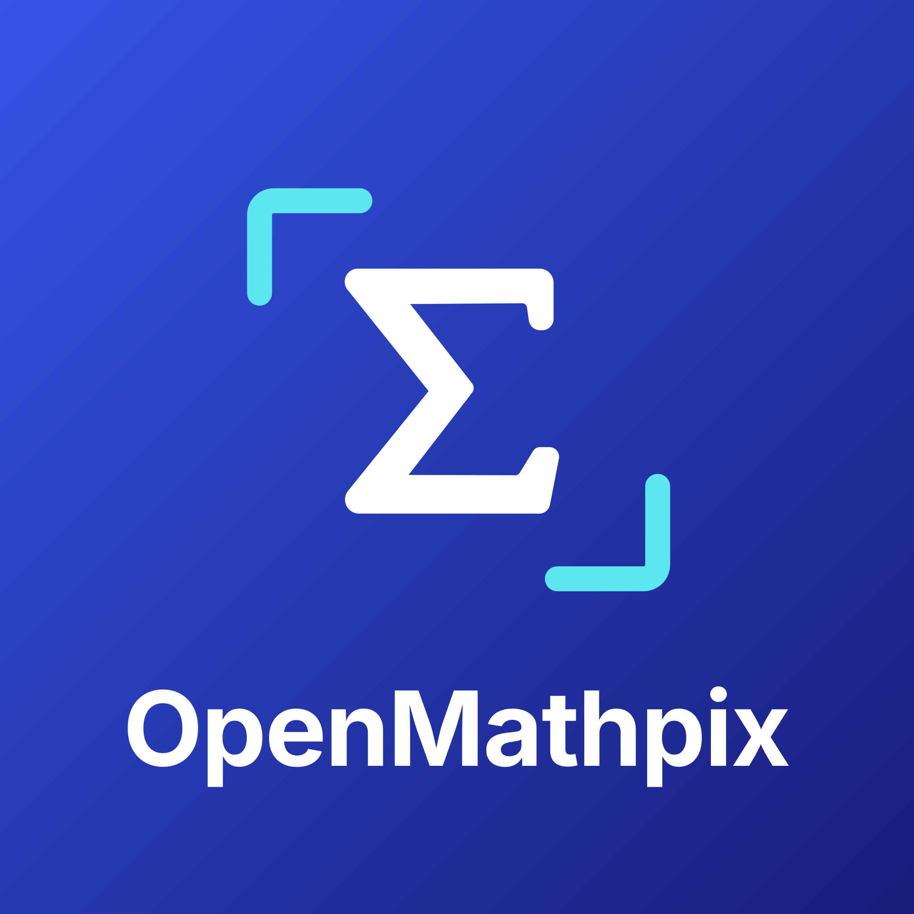
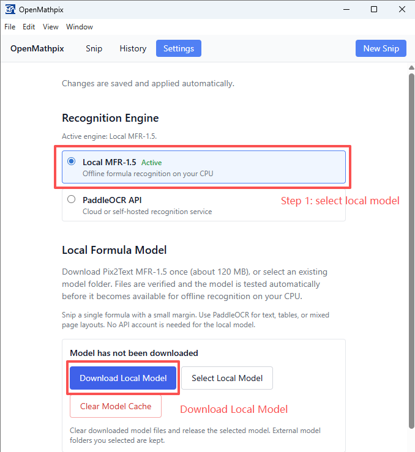
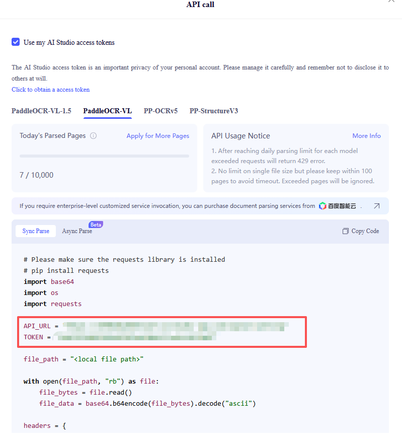
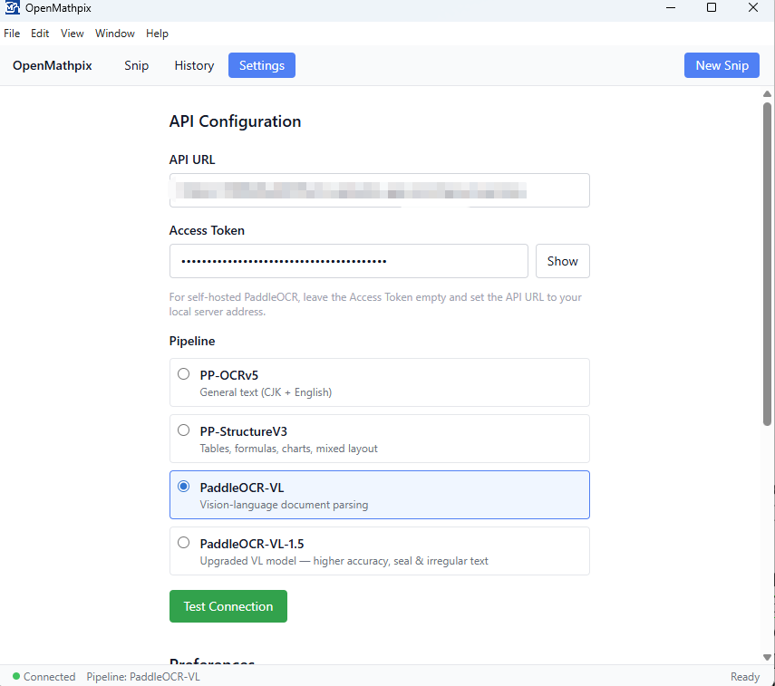
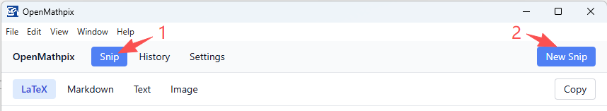
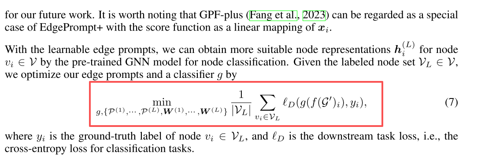
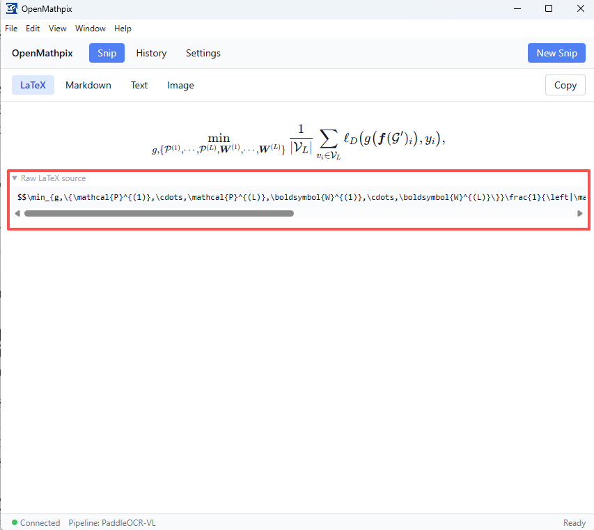
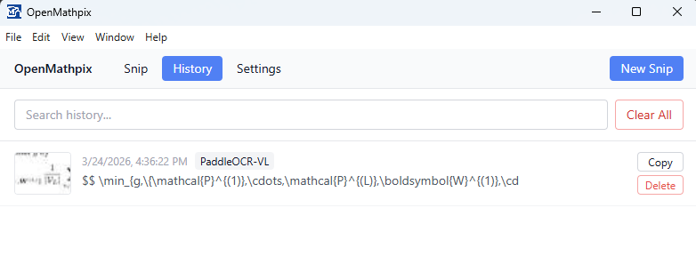

<p align="center">
  
</p>

<h1 align="center">OpenMathpix</h1>

<p align="center"><a href="README.md">English</a> · <strong>简体中文</strong></p>

<p align="center">
  开源桌面截图识别工具，使用 <a href="https://huggingface.co/breezedeus/pix2text-mfr-1.5">Pix2Text MFR-1.5</a> 在本地将公式截图转换为 LaTeX，也可通过 <a href="https://github.com/PaddlePaddle/PaddleOCR">PaddleOCR</a> API 识别文字、表格和文档版面。
</p>

---

## 安装

### Windows 便携版 (推荐)

1. 打开 [最新发布页面](https://github.com/JhuoW/OpenMathpix/releases/latest)，在 **Assets** 中下载 **OpenMathpix-portable.exe**（Windows x64）。
2. 如需使用本地公式识别，请确保已安装 [Microsoft Visual C++ x64 运行库](https://aka.ms/vc14/vc_redist.x64.exe)；已安装的用户可跳过此步。
3. 双击 **OpenMathpix-portable.exe** 启动便携版应用。
4. 按照下方的 [本地公式识别](#本地公式识别推荐) 步骤开始使用。

### 从源码构建 （可选，不推荐）

需要 Node.js 22.12 或更高版本，以及 npm。

```bash
git clone git@github.com:JhuoW/OpenMathpix.git
cd OpenMathpix
npm install
npm run dev
npm run check      # TypeScript 检查、ESLint、回归测试和生产构建
npm run package
```

## 快速开始

### 本地公式识别（推荐）

1. 打开 **Settings（设置）**，选择 **Local [MFR-1.5](https://huggingface.co/breezedeus/pix2text-mfr-1.5)**，然后点击 **Download Local Model（下载本地模型）**。
2. 首次配置需从官方 Hugging Face 仓库下载约 **120 MB** 的模型文件。下载时会显示进度并校验 SHA-256。这一步需要联网，下载完成后可离线识别。
3. 应用会自动加载和测试模型，成功后保存配置。等待模型就绪即可，无需点击保存按钮。
4. 截取单个公式并保留少量边距，也可以粘贴图片或将图片拖入窗口。

本地模式无需账号、API Token、Python、GPU 或本地大语言模型服务。图片由独立后台进程在本机 CPU 上处理，使用两个 CPU 线程。连续截图时会复用已加载的模型，空闲五分钟后释放资源。识别失败时不会自动切换到云端。新安装默认使用 Local MFR-1.5；首次升级至此版本时，旧版配置会一次性切换到本地引擎，已有 API 凭据和界面语言会保留。此后手动选择的引擎会在重启后恢复。尚未下载模型时也可以先选择本地引擎，完成模型配置后即可识别。

<div align="center">
  
</div>

MFR 适合识别 **单独截取的公式区域**，不处理图文混排页面、表格或文档版面。Markdown 输出会将识别结果包裹为独立公式，Text 输出则保留 LaTeX 源码。复杂排版、手写公式和不常见的截图仍需核对。对于空白或损坏的图片、识别超时及输出超长的情况，应用会显示错误，不会复制不完整的结果。

#### 使用手动下载的模型

如果下载失败或超时，请检查当前网络或系统代理能否访问 Hugging Face 及其文件下载服务器，然后重试。应用下载时会使用系统代理。也可以通过浏览器下载，或从另一台电脑复制模型：

1. 打开 [Hugging Face 上受支持的 MFR-1.5 固定版本](https://huggingface.co/breezedeus/pix2text-mfr-1.5/tree/1cef9f0bdcd6a4c63df7de1311fb0894593340cc)，将以下八个原始文件放入同一个文件夹：

   ```text
   encoder_model.onnx
   decoder_model.onnx
   config.json
   generation_config.json
   preprocessor_config.json
   special_tokens_map.json
   tokenizer.json
   tokenizer_config.json
   ```
2. 在 **Settings → Local MFR-1.5** 中点击 **Select Local Model（选择本地模型）**，选择该文件夹。
3. 应用会检查八个文件是否完整、SHA-256 是否匹配，再加载模型并识别测试公式。全部成功后才记住此目录；校验或加载失败时会保留之前可用的模型。

应用直接使用所选目录中的模型，请保持该目录可用，不要移动或删除文件。重启应用后会恢复已保存的选择，无需配置 API。

模型就绪后，**下载本地模型（Download Local Model）** 按钮会禁用。可在设置中点击 **清理模型缓存（Clear Model Cache）**，删除应用下载的模型并停用当前本地模型，之后下载按钮会重新启用。手动选择的外部模型文件夹及其中的原始文件不会被删除。

软件默认语言为 **English**。通过 **View → Language → 简体中文 / English**（中文界面为 **视图 → 语言**）可即时切换软件语言，重启后会保留选择。点击关闭窗口时，可选择 **缩小到任务栏**、**退出软件** 或 **取消**；缩小后软件和截图快捷键仍会继续运行。

### 可选：获取 PaddleOCR API 凭据

1. 访问 [百度 AIStudio PaddleOCR](https://aistudio.baidu.com/paddleocr)，登录或注册免费账号。
2. 点击 **API** 按钮打开模型列表，选择模型（例如 PaddleOCR-VL），查看示例代码以及对应的 API URL 和 Access Token。

<div align="center">
  
</div>

3. 从示例代码中复制以下两项：
   - **API URL**：该模型的接口地址，例如 `https://xxxxxx.aistudio-app.com/layout-parsing`。
   - **Access Token**：身份验证令牌，也可在 [Access Token 页面](https://aistudio.baidu.com/index/accessToken) 查看。

> 每个模型都有对应的 API URL，子域名可能不同。更换模型时，请同时更新接口地址。

### 可选：配置 PaddleOCR

1. 启动 OpenMathpix。
2. 点击工具栏中的 **Settings（设置）**。
3. 选择 **PaddleOCR API**，在 **API Configuration（API 配置）** 中填写：
   - **API URL**：粘贴模型对应的接口地址。
   - **Access Token**：粘贴身份验证令牌。
   - **Pipeline**：选择与 AIStudio 中的模型一致的识别流程。
4. 应用会自动用一张测试图片验证配置，成功后保存。等待保存状态提示即可；如果验证失败，修正字段后会自动重试，在此之前仍使用原有可用配置。

<div align="center">
  
</div>

### 截图并识别

#### 屏幕截图

点击工具栏中的 **Snip（截图）**，再点击 **New Snip（新建截图）**，屏幕会变暗并进入框选模式。

<div align="center">
  
</div>

按住鼠标并拖动以选择区域，松开鼠标后完成截图。

<div align="center">
  
  
</div>

## 查看结果

识别完成后，可通过四个标签页查看结果：

| 标签页             | 说明                                                                |
| ------------------ | ------------------------------------------------------------------- |
| **LaTeX**    | 通过 KaTeX 渲染识别出的公式，并提供可复制的 LaTeX 源码。            |
| **Markdown** | 显示结构化内容，例如标题、表格和行内公式；本地 MFR 输出为独立公式。 |
| **Text**     | 显示去除格式后的纯文本；本地 MFR 保留 LaTeX 源码。                  |
| **Image**    | 显示原始截图。                                                      |

**Raw LaTeX source（LaTeX 源码）** 在每次产生新结果时默认展开，点击标题可手动折叠或展开。点击 **Copy（复制）** 可复制当前标签页的内容。每次识别完成后，应用也会自动复制所选默认格式的结果。

## 识别引擎与流程

| 引擎或流程                 | 适用场景                                     | 输出                               |
| -------------------------- | -------------------------------------------- | ---------------------------------- |
| **MFR-1.5（本地）**  | 单个公式的截图                               | LaTeX，以及包含独立公式的 Markdown |
| **PP-OCRv5**         | 通用文字，包括中日韩文字及英文               | 纯文本                             |
| **PP-StructureV3**   | 公式、表格、图表及混合版面                   | Markdown + LaTeX                   |
| **PaddleOCR-VL**     | 视觉语言文档解析                             | Markdown + LaTeX                   |
| **PaddleOCR-VL-1.5** | 更高精度的文档解析，以及印章和不规则文字识别 | Markdown + LaTeX                   |

> 使用 PaddleOCR 时，各个流程在 AIStudio 上都有对应的 API URL。切换流程后，请在设置中同步更新地址。

## 设置

| 设置项                        | 默认值             | 说明                                                    |
| ----------------------------- | ------------------ | ------------------------------------------------------- |
| OCR Engine（识别引擎）        | Local MFR-1.5      | 选择本地公式识别或 PaddleOCR API；已有 API 凭据会保留。 |
| API URL                       | —                 | PaddleOCR AIStudio 接口地址。                           |
| Access Token                  | —                 | 通过 safeStorage 加密后存储在本地。                     |
| Pipeline（识别流程）          | PP-StructureV3     | 使用 PaddleOCR 时选择对应的识别流程。                   |
| Snip Hotkey（截图快捷键）     | `Ctrl+Shift+S`   | 屏幕截图的全局快捷键。                                  |
| Default Output（默认输出）    | LaTeX              | 识别完成后自动复制的格式。                              |
| Theme（主题）                 | System（跟随系统） | 支持浅色、深色或跟随系统。                              |
| History Limit（历史记录上限） | 100                | 最多保存的识别记录数，可设置为 10–500。                |

**自托管服务：** 将 API URL 设置为自己的服务地址（例如 `http://localhost:8080`），并将 Token 留空。

所有设置都会自动保存，并在验证通过后生效。文本字段在短暂停止输入或离开输入框时应用；下拉框和开关在选择后立即应用。模型和 API 配置变化时会显示校验或加载状态。应用失败时保留之前可用的配置，成功保存的设置会在重启后恢复。

如果快捷键被占用、URL 或历史记录上限无效、模型加载失败，或保存 Token 时系统密钥环不可用，设置页会显示错误，方便修正，同时保留原有可用设置。

## 历史记录

点击工具栏中的 **History（历史记录）** 浏览之前的识别结果。每条记录都包含缩略图、时间和结果预览。可以使用搜索栏筛选，也可以点击记录重新打开结果。

<div align="center">
  
</div>

## 系统托盘

关闭窗口后，应用会最小化到系统托盘。右键点击托盘图标可使用以下功能：

- **Snip**：开始截图。
- **Open Window**：显示主窗口。
- **Settings**：打开设置。
- **Quit**：退出应用。

## 快捷键

| 快捷键           | 功能                     |
| ---------------- | ------------------------ |
| `Ctrl+Shift+S` | 屏幕截图（全局快捷键）。 |
| `Ctrl+V`       | 粘贴图片并识别。         |
| `Escape`       | 取消截图。               |

## 许可证

MIT
