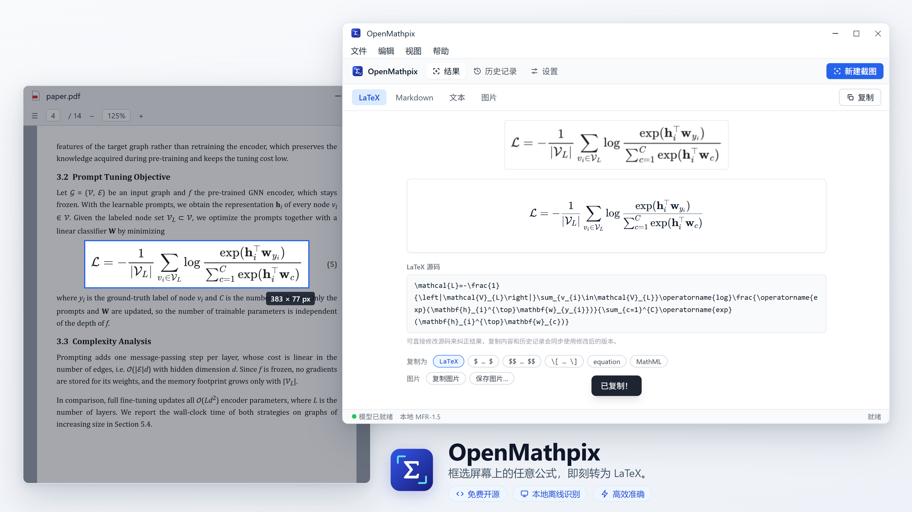
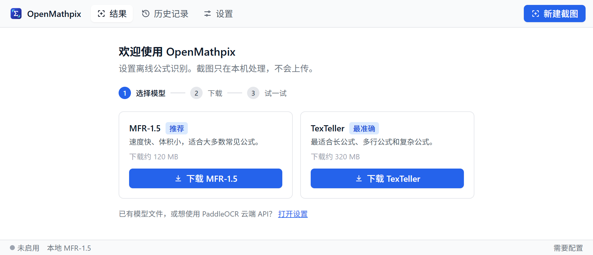
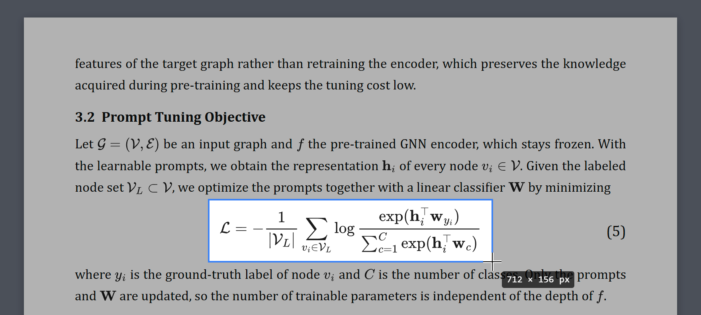
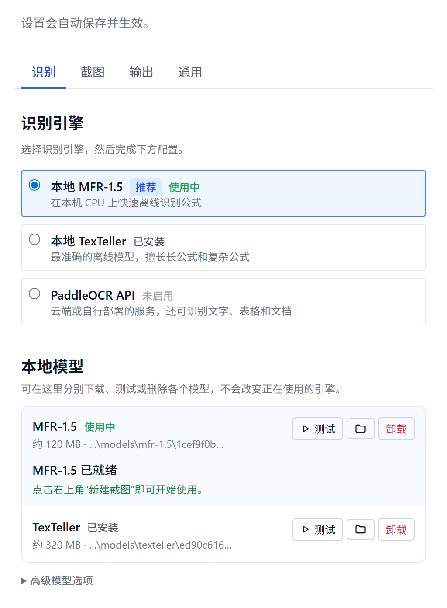
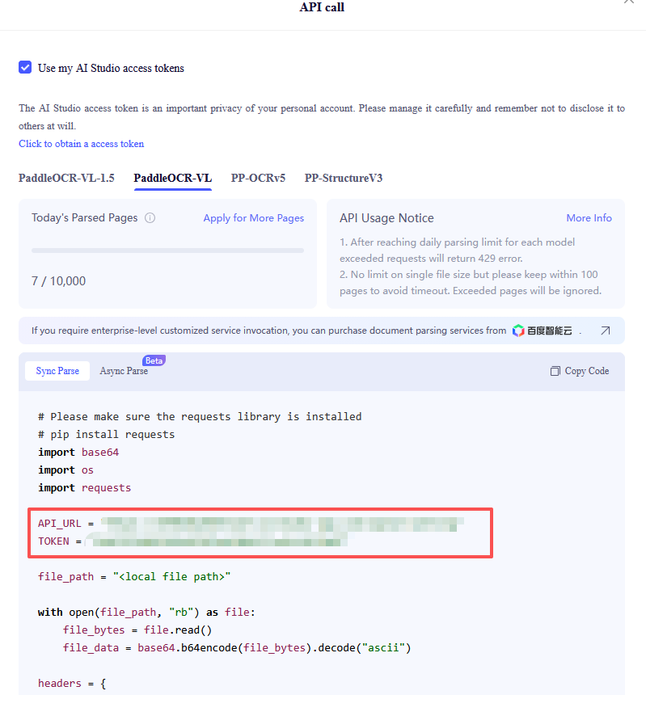
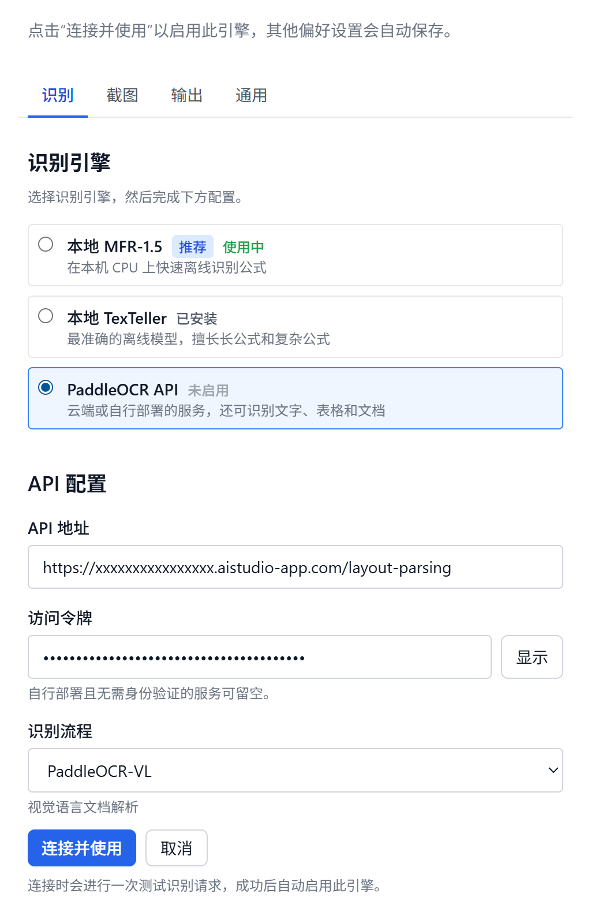

<p align="center">
  
</p>

<p align="center">
  <b>OpenMathpix：框选屏幕上的任意公式，即刻转为 LaTeX。</b><br />
  免费开源 · 本地离线识别 · 高效准确
</p>

<p align="center">
  <a href="https://github.com/JhuoW/OpenMathpix/releases/latest"></a>
  <a href="LICENSE"></a>
  <a href="README.md"></a>
</p>

## 功能亮点

- **随处截取。** PDF、幻灯片、网页、视频、扫描笔记都可以。按下 `Ctrl+Shift+S`，框选公式，
  LaTeX 就已经在剪贴板里了。也可以直接粘贴或拖入图片。
- **隐私优先。** 识别在本机 CPU 上完成，截图不会离开你的电脑。
- **两个本地模型。** 默认模型速度快，适合日常公式；另一个模型更大，擅长长公式、多行公式和矩阵。
  点击一次即可下载，之后完全离线使用。
- **复制即可用。** 可复制为 LaTeX、`$…$`、`$$…$$`、`\[…\]`、`equation` 环境，或 MathML
  （粘贴到 Microsoft Word 中即为可编辑公式）。需要图片时，可 **复制图片** 或 **保存图片…** 为 PNG / SVG。
- **方便修改。** 直接修改源码修正个别符号，预览实时更新。近期结果保存在可搜索的历史记录中。
- **不打扰工作。** 常驻系统托盘，随 Windows 自动启动。也可以设为后台复制，只在角落弹出一个小提示，不打开主窗口。
- 支持 English / 简体中文界面、浅色与深色主题，以及应用内更新。

## 下载安装

1. 在 [最新发布页面](https://github.com/JhuoW/OpenMathpix/releases/latest) 下载
   **OpenMathpix-Setup-&lt;版本号&gt;-x64.exe**（Windows 10 / 11，x64）。
2. 运行安装程序。安装程序暂未进行代码签名，Windows SmartScreen 可能提示“Windows 已保护你的电脑”，
   点击 **更多信息 → 仍要运行** 即可。每个版本都附有 `.sha256` 校验文件，可用
   `certutil -hashfile <文件> SHA256` 核对。
3. 本地模型依赖 [Microsoft Visual C++ x64 运行库](https://aka.ms/vc14/vc_redist.x64.exe)，大多数电脑已经安装。
   如果模型加载失败，请安装后重试。

## 快速上手

1. **选择模型。** 首次启动时，引导页会帮你选择并下载模型（约 120 MB），然后用示例公式测试。

   
2. **截图。** 在任意应用中按 `Ctrl+Shift+S`，或点击 **新建截图**。屏幕变暗后，拖动鼠标框选公式并保留少量边距。
   按 `Esc` 或单击右键可取消。

   
3. **粘贴。** 识别结果会自动复制。可在 **设置 → 输出** 中更改默认格式，也可以在结果页使用 **复制为**。

## 选择模型

|          | **MFR-1.5**（默认） | **TexTeller**                          |
| -------- | ------------------------- | -------------------------------------------- |
| 适合     | 单个公式、行内公式        | 长公式、多行公式、矩阵、分段函数、对齐方程组 |
| 速度     | 最快                      | 较慢，但最准确                               |
| 下载大小 | 约 120 MB                 | 约 320 MB                                    |
| 运行内存 | 约 0.3 GB                 | 约 0.8 GB                                    |

两个模型可以同时安装，随时在 **设置 → 识别** 中切换。只有正在使用的模型会被加载，空闲几分钟后自动释放。
在 **本地模型** 列表中可以用示例公式测试模型、打开模型文件夹或删除模型。

模型从 Hugging Face 下载，每个文件都会按固定的 SHA-256 校验。如果 Hugging Face 速度慢或无法访问，
可展开 **高级模型选项**，将 **下载源** 切换为 **hf-mirror.com（镜像）**。取消的下载会从中断处继续。

<p align="center">
  
</p>

## 快捷键

| 快捷键                  | 功能                               |
| ----------------------- | ---------------------------------- |
| `Ctrl+Shift+S`        | 在任意应用中截图（可在设置中修改） |
| `Ctrl+N`              | 在主窗口中新建截图                 |
| `Ctrl+V`              | 识别粘贴的图片                     |
| `Ctrl+Shift+V`        | 识别剪贴板中的图片                 |
| `Ctrl+Shift+C`        | 复制当前识别结果                   |
| `Ctrl+1` / `Ctrl+2` | 结果 / 历史记录                    |
| `Ctrl+,`              | 设置                               |
| `Esc` / 右键          | 取消截图                           |

## 更多

<details>
<summary><b>用 PaddleOCR 识别文字、表格和整页文档（可选，需联网）</b></summary>

<br />

本地模型专注于公式。如需识别文字、表格和图文混排页面，可以连接百度 AI Studio 的
[PaddleOCR](https://github.com/PaddlePaddle/PaddleOCR) 服务（免费账号），或你自己部署的 PaddleOCR 服务。
使用此引擎时，截图会发送到该服务。

1. 登录 [aistudio.baidu.com/paddleocr](https://aistudio.baidu.com/paddleocr)，点击 **API**，选择模型，
   从示例代码中复制 `API_URL` 和 `TOKEN`。

   
2. 在 **设置 → 识别** 中选择 **PaddleOCR API**，填写 **API 地址** 和 **访问令牌**，并选择对应的 **识别流程**。
3. 点击 **连接并使用**。OpenMathpix 会发送一张小测试图片，成功后才切换到 PaddleOCR。令牌会加密保存。

   

| 识别流程         | 适用场景                       |
| ---------------- | ------------------------------ |
| PP-OCRv5         | 纯文字，支持中文和英文         |
| PP-StructureV3   | 公式、表格、图表及图文混排     |
| PaddleOCR-VL     | 基于视觉语言模型的文档解析     |
| PaddleOCR-VL-1.5 | 更高精度，支持印章和不规则文字 |

每个识别流程都有各自的 API 地址，切换流程时请同步更新。使用自行部署的服务时，填写其地址
（例如 `http://localhost:8080`），令牌留空即可。

</details>

<details>
<summary><b>不通过应用下载，手动安装模型</b></summary>

<br />

用浏览器下载以下文件（或从另一台电脑复制），放入同一个文件夹，然后在
**设置 → 识别 → 本地模型** 中点击 **导入…** 并选择该文件夹。OpenMathpix 会校验每个文件，
并直接使用该文件夹，请不要移动或删除它。

- **MFR-1.5**，来自[此固定版本](https://huggingface.co/breezedeus/pix2text-mfr-1.5/tree/1cef9f0bdcd6a4c63df7de1311fb0894593340cc)：
  `encoder_model.onnx`、`decoder_model.onnx`、`config.json`、`generation_config.json`、
  `preprocessor_config.json`、`special_tokens_map.json`、`tokenizer.json`、`tokenizer_config.json`
- **TexTeller**，来自[此固定版本](https://huggingface.co/onnx-community/TexTeller3-ONNX/tree/ed90c6164810242882ca90863bb85697a76f4841)：
  `onnx/encoder_model_int8.onnx`、`onnx/decoder_model_merged_int8.onnx`、`config.json`、
  `generation_config.json`、`preprocessor_config.json`、`tokenizer.json`
  （两个 `.onnx` 文件需与其他文件放在同一层，不要放在子文件夹中）

</details>

<details>
<summary><b>从源码构建</b></summary>

<br />

需要 Node.js 22.12 或更高版本。

```bash
git clone https://github.com/JhuoW/OpenMathpix.git
cd OpenMathpix
npm install
npm run dev        # 以开发模式运行
npm run check      # 类型检查、代码检查、测试和生产构建
npm run package    # 在 dist/ 中生成 Windows 安装包
```

</details>

## 隐私

使用本地模型时，图片在你的电脑上识别，不会上传。OpenMathpix 只在下载模型或你点击
**帮助 → 检查更新** 时联网。如果连接了 PaddleOCR，截图会发送到你配置的服务。

## 参与贡献

欢迎有兴趣的开发者协助开发和测试 Mac 版本（*我还在攒钱买 Mac 😄*），包括屏幕录制权限适配、原生窗口与菜单交互，以及 Apple Silicon 和 Intel Mac 的应用打包。

欢迎[提交 Issue](https://github.com/JhuoW/OpenMathpix/issues) 交流，或[提交 Pull Request](https://github.com/JhuoW/OpenMathpix/pulls)。

## 许可证

OpenMathpix 采用 [GNU AGPL v3.0](LICENSE)（AGPL-3.0-only）许可证。

本项目基于 [Pix2Text MFR](https://github.com/breezedeus/Pix2Text)、[TexTeller](https://github.com/OleehyO/TexTeller)、
[ONNX Runtime](https://onnxruntime.ai)、[KaTeX](https://katex.org)、[MathJax](https://www.mathjax.org) 和
[PaddleOCR](https://github.com/PaddlePaddle/PaddleOCR) 构建。这些项目的代码和模型权重保留各自的许可证，
详见[第三方声明](THIRD_PARTY_NOTICES.md)。
